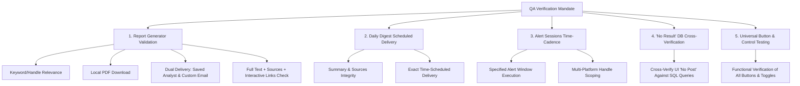

# Social Media Insights: Event Summarizer & Daily Digest
## QA Release Notes & Functional Test Mandate

**Release Build:** v2.4.1-QA-Verified  
**Application URL:** `http://10.10.116.215:8085/`  
**Database Connection:** PostgreSQL (`shaktidb_social` on `10.10.116.215:13366`)  
**LLM Inference Endpoint:** Local Gemma 4 26B (`10.10.116.215:30004/v1`)  

---

## 1. Executive Summary of Testing Mandate

This release note establishes the official Quality Assurance (QA) verification protocol for the **Social Media Insights** platform. Testing must focus on five core operational pillars:

---

## 2. Core Functional Test Areas

---

### AREA 1: Report Generator End-to-End Functional Testing

#### Test Objective 1.1: Query Relevance for Given Handles & Keywords
* **Requirement**: Reports must be strictly relevant and contextual to the entered `@handles` and keywords.
* **Execution**:
  1. Input specific handles and topics: e.g. `@anshu217, @mfa_china, border dispute`.
  2. Select target channels (e.g. Twitter, Telegram).
  3. Set a valid date range and click **Generate Report**.
* **Verification Check**:
  * [ ] Verify the AI summary synthesized directly addresses the specified accounts and topic.
  * [ ] Verify the content does not produce irrelevant hallucinated events unrelated to the keywords.
  * [ ] Verify that entering `@handles` **does NOT** auto-check any platform checkboxes.

#### Test Objective 1.2: Local PDF Download
* **Requirement**: The complete report must be downloadable locally as a cleanly formatted document.
* **Execution**:
  1. After generating a report, click the **⬇ Download PDF** button in the top-right header of the report card.
* **Verification Check**:
  * [ ] Verify the browser print/save preview opens immediately.
  * [ ] Verify the downloaded/printed document contains:
    - Full report title, date range, and parameters.
    - Complete executive summary narrative with citation numbers.
    - Complete **Sources (N)** section with all post snippets, dates, author `@handles`, and links.
   

#### Test Objective 1.3: Dual Email Delivery (Saved Analyst vs. Custom Email)
* **Requirement**: The system must successfully deliver reports to both saved analysts from the database and ad-hoc custom email addresses.
* **Execution**:
  * **Test A (Saved Analyst)**: Select an analyst from the **SEND REPORT TO** dropdown (e.g. `Bootstrap Admin (go.teamchai@gmail.com)` or `Beta Alpha (clidelhi96@gmail.com)`). Click **✉ Send**.
  * **Test B (Custom Email)**: Click **+ Custom email**, enter your own email address (or comma-separated addresses), and click **✉ Send**.
* **Verification Check**:
  * [ ] Status feedback message displays green confirmation: `Sent to <email>.`
  * [ ] Both the saved analyst email and custom email receive the dispatch.
  * [ ] Ensure there is a clean, visible **24px gap** between the email input box and the **✉ Send** button with no overlapping borders.

#### Test Objective 1.4: Completeness of Emailed Report (Text, Sources & Interactive Links)
* **Requirement**: The received email must include 100% of the generated text, full source citations, and functioning links.
* **Execution**:
  1. Open the received email in Gmail or your email client.
* **Verification Check**:
  * [ ] **Executive Summary**: Full markdown-styled text with bolding and section headers is present.
  * [ ] **Sources Section**: Shows **Sources (N)** matching the exact count in the dashboard (MUST NOT say `Sources (0)`).
  * [ ] **Source Details**: Each source card displays citation number (`#1`, `#2`, etc.), author `@handle`, platform badge, date, snippet, and external URL link (`Link ↗`).
  * [ ] **Interactive Links**: Clicking on any citation tag (e.g. `[#1]`) jumps to the corresponding source card, and clicking `Link ↗` opens the live post URL.

---

### AREA 2: Daily Digest Functional Testing

#### Test Objective 2.1: Summary Points, Sources & Interactive Links
* **Requirement**: Daily Digest summaries must accurately synthesize the monitored topics with complete citations and links.
* **Execution**:
  1. Navigate to the **Daily Digest** tab.
  2. Enter targeted keywords and handles in the search box (e.g. `@war_monitor, Ukraine, China`).
  3. Select channels on the right (Twitter, Telegram, Reddit).
  4. Enter your email address and click **Save**.
  5. Click **Send Test Now**.
* **Verification Check**:
  * [ ] Emailed digest contains executive summary matching the keywords.
  * [ ] Emailed digest contains the complete numbered list of cited source posts.
  * [ ] External links and citation anchors function properly.

#### Test Objective 2.2: Scheduled Time-Based Delivery
* **Requirement**: The daily digest must automatically trigger and send to the specified email at the exact configured time.
* **Execution**:
  1. In the **TIME** field, set the dispatch time to **2 minutes in the future** (e.g. if current IST time is `19:35`, set `19:37`).
  2. Ensure the **Enabled** checkbox is checked and click **Save**.
  3. Wait until the clock reaches the scheduled time.
* **Verification Check**:
  * [ ] The email arrives automatically in the inbox at the scheduled time without manual intervention.
  * [ ] The **RUN HISTORY** table below records a new row with the date, sent timestamp, matched post count, and status `sent`.

---

### AREA 3: Alert Sessions Functional Testing

#### Test Objective 3.1: Time Cadence & Specified Interval Alerts
* **Requirement**: Continuous surveillance sessions must accurately evaluate monitoring windows and trigger alerts for the configured frequency.
* **Execution**:
  1. Navigate to **Alert Sessions** and click **+ New Alert Session**.
  2. Card 1: Enter a name (e.g. `Border Alert Alpha`) and choose interval (e.g. `1h`, `4h`, or custom times `00:00, 06:00, 12:00, 18:00`).
  3. Card 2: Select monitored platforms and handles.
  4. Card 3: Enter your notification email and click **Create Session**.
  5. On the created session card, click **Run Now** to evaluate the immediate window.
* **Verification Check**:
  * [ ] Immediate window evaluates and dispatches an alert email to the recipient.
  * [ ] Background 60-second ticker triggers the alert automatically when the next window boundary is reached.
  * [ ] The session card displays the correct upcoming alert time under **NEXT ALERT WINDOW**.
  * [ ] Clicking **History** on the session card displays window execution logs with timestamps and post counts.

#### Test Objective 3.2: Multi-Platform Handle Isolation in Handle Library
* **Requirement**: Selecting handles under one platform tab must not select or impact handles under other platforms.
* **Execution**:
  1. In the Alert Session modal (Card 2), click the **Telegram** platform tab.
  2. Click **Select all** on the Telegram tab. Observe the counter badge.
  3. Switch to the **Twitter** tab, then the **Instagram** tab.
* **Verification Check**:
  * [ ] Only Telegram handles are selected; Twitter and Instagram counters remain at `0`.
  * [ ] Handle selection is strictly isolated per platform tab.

---

### AREA 4: Mandatory Database Cross-Verification for "No Post / No Result" States

> [!IMPORTANT]
> **CRITICAL QA RULE**: Whenever the UI, Daily Digest, or Alert Session returns:
> *"No relevant social media posts were found for this period"* or *"No matching posts found"*
> **QA must NEVER assume it is normal.** You MUST cross-verify against the PostgreSQL database (`shaktidb_social`) to confirm whether matching data actually exists in the database.

---

### AREA 5: General Functional Verification of All Buttons & Controls

Verify that every button and interactive control across the entire web application executes its intended function without console errors:

| Screen / Component | Button / Control Under Test | Expected Functional Behavior | QA Check |
| :--- | :--- | :--- | :--- :--- |
| **Top Navigation** | `Report Generator`, `Daily Digest`, `Alert Sessions` tabs | Smoothly switches between active view panels without reload. | [ ] PASS |
| **Report Generator** | `all` / `none` platform shortcuts | Selects or unselects all 14 platform checkboxes simultaneously. | [ ] PASS |
| **Report Generator** | `Summary` / `Report` depth toggle | Switches active button styling and alters output prompt length. | [ ] PASS |
| **Report Generator** | `Generate Report` button | Enters loading state (`Generating Report...`), executes API call, renders results. | [ ] PASS |
| **Report Generator** | `+ Custom email` / `✕ Use analyst list` toggle | Toggles between the analyst dropdown and the custom email input field. | [ ] PASS |
| **Report Generator** | `✉ Send` button | Validates email syntax, triggers `/api/send_report`, displays green feedback. | [ ] PASS |
| **Report Generator** | `⬇ Download PDF` button | Formats page for printing and triggers system print dialog. | [ ] PASS |
| **Daily Digest** | `all` / `none` platform shortcuts | Selects or clears all 14 digest platform checkboxes. | [ ] PASS |
| **Daily Digest** | `Save` button | Persists settings via `/api/digest_settings`, updates cron, displays confirmation. | [ ] PASS |
| **Daily Digest** | `Send Test Now` button | Dispatches on-demand test digest email and writes row to RUN HISTORY table. | [ ] PASS |
| **Daily Digest** | `↻ Refresh Log` button | Reloads the RUN HISTORY table via `/api/digest/history/1`. | [ ] PASS |
| **Alert Sessions** | `+ New Alert Session` button | Opens the 3-card creation modal with initial defaults. | [ ] PASS |
| **Alert Sessions Modal** | Platform tab buttons (14 networks) | Switches active platform handle view and isolates handle chip counters. | [ ] PASS |
| **Alert Sessions Modal** | `Select all` / `Clear all` handle buttons | Selects or unselects handles *only* for the active platform tab. | [ ] PASS |
| **Alert Sessions Modal** | `Save Session` / `Cancel` | Validates input, saves session via API, closes modal. | [ ] PASS |
| **Alert Sessions Cards** | `Run Now` button | Forces immediate evaluation of current surveillance window. | [ ] PASS |
| **Alert Sessions Cards** | `Pause` / `Resume` toggle | Toggles session state between `ACTIVE` and `PAUSED`. | [ ] PASS |
| **Alert Sessions Cards** | `History` button | Opens execution modal showing past window timestamps and post counts. | [ ] PASS |
| **Alert Sessions Cards** | `Delete` button | Prompts confirmation and permanently deletes session from database. | [ ] PASS |

---

### AREA 6: Keyword & Handle Relevance (Zero Unrelated Posts Enforcement)

> [!NOTE]
> **Resolution of Unrelated Posts / Rogue Keywords Issue**:
> 1. **Word-Boundary Matching (`~* '\ykeyword'`)**: Text queries now enforce word boundaries in PostgreSQL. Searching `war` will **never** match substring occurrences in unrelated words like `software`, `hardware`, `award`, or `toward`.
> 2. **Author Handle Substring Isolation**: Keyword searches no longer perform partial substring `LIKE '%kw%'` checks against author usernames. Typing a generic keyword will **never** match an author merely because the author's handle contains the letters (e.g. `wen` will never match `@OmwengaMargaret` or `@twensor`).
> 3. **Conjunctive Handle + Keyword Filtering (`AND`)**: When a user inputs both `@handles` and `keywords` (e.g. `@anshu217, drone`), the backend now strictly applies `(handle) AND (keyword)`, returning only posts from that handle that discuss that topic.
> 4. **Python-Level Relevance Enforcement**: Posts undergo a secondary validation layer prior to LLM summarization and UI presentation, dropping any off-topic sources.
> 5. **Strict LLM Synthesis Prompting**: LLM prompt strictly orders the model to ignore any off-topic chatter and omit sections for unqueried topics.

